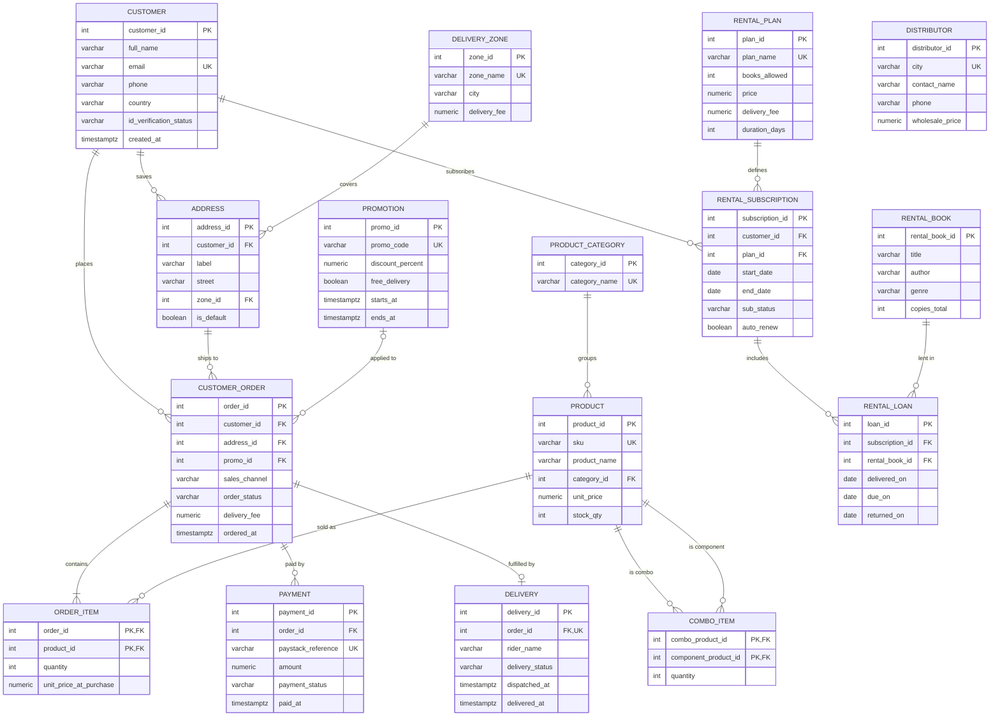
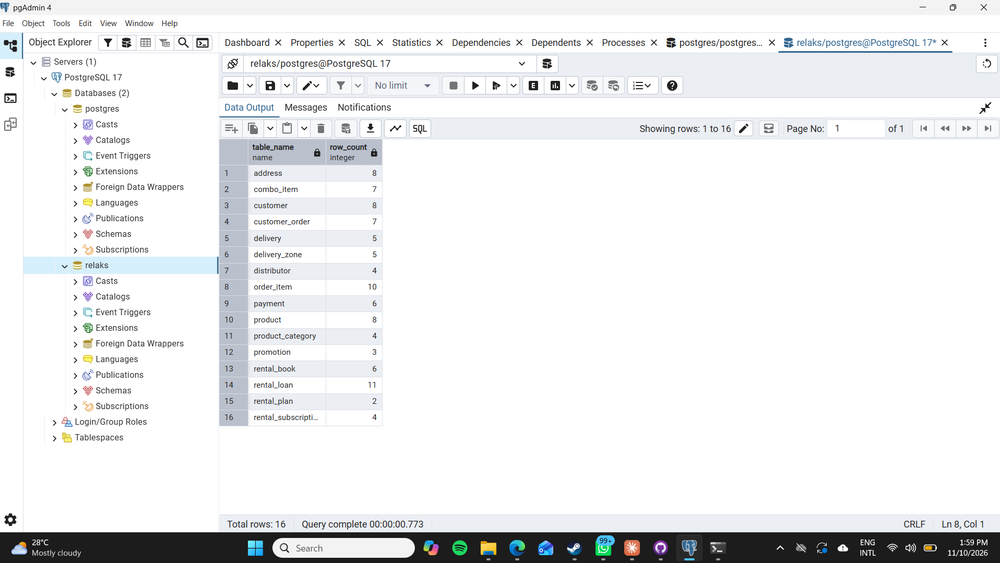
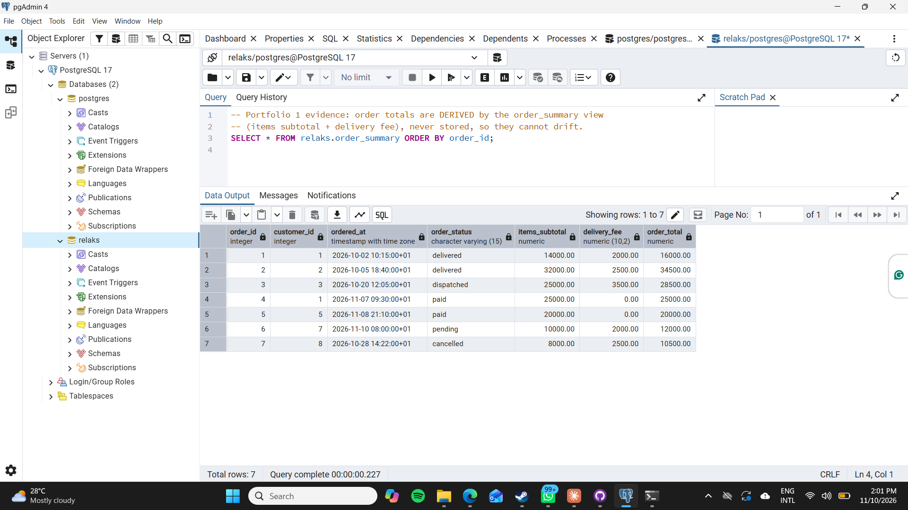
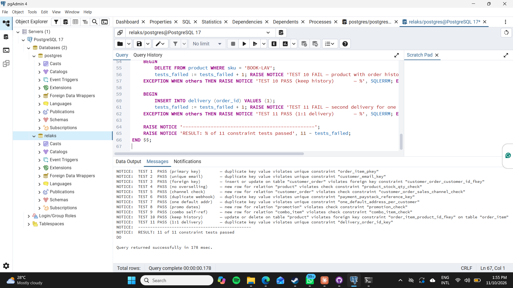

# Portfolio 1 — Database Design and Modelling

**Case study:** Relaks — a Lagos-based wellness brand that sells coloring books and stationery and runs the Relaks Reading Club, a book-rental subscription. (Full case-study statement is in the [root README](../README.md).)

## Files

| File | What it does |
|---|---|
| `01_schema.sql` | Creates the `relaks` schema: 16 tables, 1 view, all keys and constraints |
| `02_sample_data.sql` | Loads a small simulated dataset (fictional customers, real Relaks product range and prices) |
| `03_constraint_tests.sql` | 11 deliberately invalid statements that prove the constraints reject bad data |
| `er-diagram.mmd` | ER diagram source (Mermaid). GitHub renders it below |
| `screenshots/` | Evidence of the scripts running on my machine |

## How to run

```bash
psql -U postgres -c "CREATE DATABASE relaks;"
psql -U postgres -d relaks -f 01_schema.sql
psql -U postgres -d relaks -f 02_sample_data.sql
psql -U postgres -d relaks -f 03_constraint_tests.sql
```

## 1. Entities and why each exists

| Area | Tables | Business reason |
|---|---|---|
| Customers | `customer`, `address`, `delivery_zone` | One customer can save several addresses. The delivery fee depends on the Lagos zone (₦2,000–₦5,000), so the fee lives on the zone, not on every address. |
| Catalogue | `product`, `product_category`, `combo_item` | The Pink, Teal and Lavender editions, plus pencils, felt pens and tote bags. A combo is a product built from other products. |
| Selling | `customer_order`, `order_item`, `promotion` | Orders come in through the website, Instagram, WhatsApp, TikTok and X. Black Friday promo codes attach to orders. |
| Money & fulfilment | `payment`, `delivery` | Paystack payment attempts and rider delivery tracking. |
| Outside Lagos | `distributor` | Customers in Kano, Abuja, Port Harcourt and Ibadan buy through a city distributor at the wholesale price. It's a reference table that isn't linked to orders, because distributor sales happen outside the website. |
| Reading Club | `rental_plan`, `rental_book`, `rental_subscription`, `rental_loan` | Monthly plan (2 books, ₦8,000 + ₦6,000 delivery) and Quarterly plan (5 books, ₦22,500 + ₦6,000). Every book handed to a subscriber is a loan. |

### ER diagram



## 2. Relationships and cardinality

| Relationship | Cardinality | How it is implemented |
|---|---|---|
| Customer → Address | 1 : N | `address.customer_id` FK |
| Delivery zone → Address | 1 : N | `address.zone_id` FK |
| Customer → Order | 1 : N | `customer_order.customer_id` FK |
| Order ↔ Product | **M : N** | Resolved by the junction table `order_item` (composite PK `order_id, product_id`) |
| Product ↔ Product (combos) | **M : N, recursive** | Resolved by `combo_item`, where both FKs point back to `product` |
| Promotion → Order | 0..1 : N | `customer_order.promo_id` is a **nullable** FK, because most orders have no promo |
| Order → Payment | 1 : N | One order can have several attempts (declined card, then retry) |
| Order → Delivery | 1 : 0..1 | `delivery.order_id` is both FK **and UNIQUE**, which turns the 1:N into a 1:1 |
| Customer → Subscription → Loan ← Book | 1 : N : 1 | `rental_loan` is effectively the junction between subscriptions and books |

## 3. Keys and constraints

| Type | Where | What it protects against |
|---|---|---|
| Surrogate PK (`GENERATED ALWAYS AS IDENTITY`) | All entity tables | Names and emails can change, but an ID never does. |
| Composite PK | `order_item`, `combo_item` | The same product appearing twice as separate rows in one order. Quantity handles repeats instead. |
| Natural-key UNIQUE | `customer.email`, `product.sku`, `promotion.promo_code` | Duplicate accounts, SKUs or promo codes |
| UNIQUE `payment.paystack_reference` | `payment` | **A Paystack webhook being applied twice.** A real failure in e-commerce, because Paystack retries its webhooks. |
| CHECK `stock_qty >= 0` | `product` | Overselling. The last database-level safety net (Portfolio 3 handles the race condition properly). |
| CHECK enums | status and channel columns | Typos like `'deliverd'` or unsupported channels |
| CHECK date logic | `promotion`, `delivery`, `rental_*` | A promo ending before it starts, a delivery before dispatch, a book returned before it was delivered |
| Partial UNIQUE index | `address (customer_id) WHERE is_default` | A customer having two "default" addresses |
| FK `ON DELETE CASCADE` | `address`, `order_item`, `delivery` | These rows mean nothing without their parent, so they are removed together. |
| FK default (RESTRICT) | `order_item.product_id` and others | Deleting a product that is in past orders. History must be kept, so products are retired with `is_active = FALSE` instead. |

**Privacy decision:** Reading Club renters must verify their identity (NIN, passport, etc.) before borrowing. The database stores only `id_verification_status`, never the ID number. The external verification provider holds that, which keeps sensitive identifiers out of our system.

`03_constraint_tests.sql` tries to break each of these rules. All 11 statements are rejected and the data is left unchanged (see `screenshots/`).

## 4. Normalisation

### Starting point: the old order spreadsheet (UNF)

Before the website shop, orders were tracked in a spreadsheet exported from a storefront tool. One row per order looked like this:

| order_no | customer_name | phone | address | zone | zone_fee | items | channel | paid | ref |
|---|---|---|---|---|---|---|---|---|---|
| 101 | Adaeze Okafor | 0801… | 12 Herbert Macaulay | Yaba | 2000 | Pink x1 @10000, Pencils x1 @4000 | website | 16000 | PSK-0001 |

**Problems:** `items` holds a *list* inside one cell (a repeating group). Customer details are retyped on every order. The zone fee is copied onto every row.

### 1NF: atomic values, no repeating groups

Split `items` so each product gets its own row, with atomic columns `product`, `qty` and `unit_price`. The key becomes **(order_no, product)**.

Still a problem: the customer's name, phone and address now repeat on every product row of the same order.

### 2NF: remove partial dependencies

In 1NF, with the composite key (order_no, product):

- `customer_name`, `address`, `channel`, `zone_fee` depend on **order_no only** → partial dependency → moved to **ORDER**
- `product_name`, current `unit_price` depend on **product only** → moved to **PRODUCT**
- `qty` and `unit_price_at_purchase` depend on the **whole key** → stay in **ORDER_ITEM**

### 3NF: remove transitive dependencies

Within ORDER:

- `order_no → customer_id → customer_name, phone, email`. That's a transitive dependency, so these move to **CUSTOMER**.
- `order_no → address → zone → zone_fee`, so these move to **ADDRESS** and **DELIVERY_ZONE**.
- `product → category_name` moves to **PRODUCT_CATEGORY**.

The result is the schema in `01_schema.sql`. Every non-key attribute depends on *the key, the whole key, and nothing but the key*.

### Deliberate, controlled exceptions

| Column | Why it looks redundant | Why it is kept |
|---|---|---|
| `order_item.unit_price_at_purchase` | `product.unit_price` already exists | It is a **historical fact**, not a duplicate. Prices change, and Black Friday discounts end, but a receipt must not change afterwards. |
| `customer_order.delivery_fee` | `delivery_zone.delivery_fee` already exists | Same reasoning. Free-delivery promos also set it to ₦0 for that order only. |
| Order **total** | Not stored at all | Derived on demand by the `order_summary` view, so there's no stored total that can drift from its line items. |

## 5. Evidence

All three were run on my own laptop (PostgreSQL 17, pgAdmin 4) on 10 November 2026.

**1. Schema created:** all 16 tables in the `relaks` database, with their row counts after loading the sample data.



**2. Sample data and derived totals:** `SELECT * FROM relaks.order_summary;` Each order total is calculated as items subtotal + delivery fee, and matches its Paystack payment amount where one exists.



**3. Constraint tests:** all 11 invalid operations are rejected, with PostgreSQL's own error message for each one.


