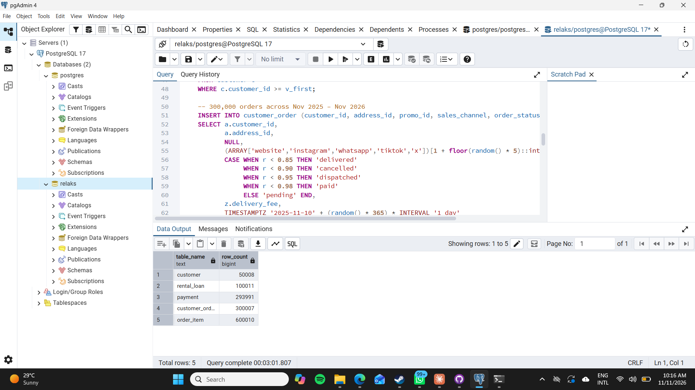
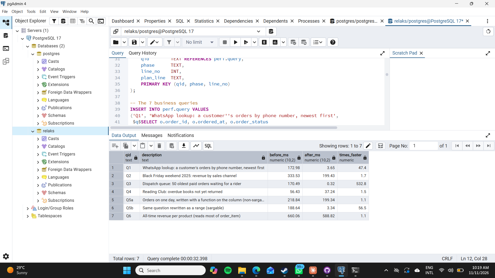
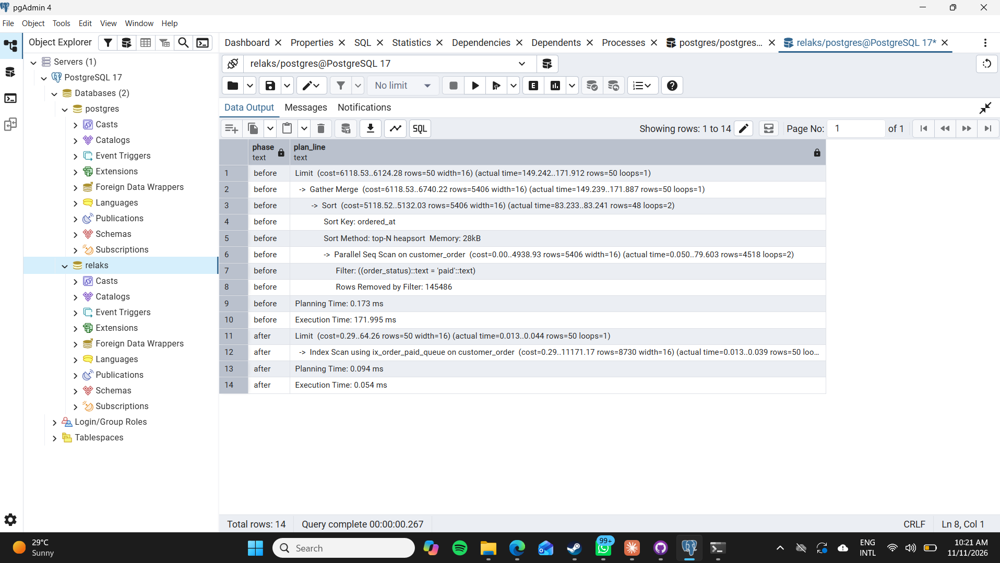
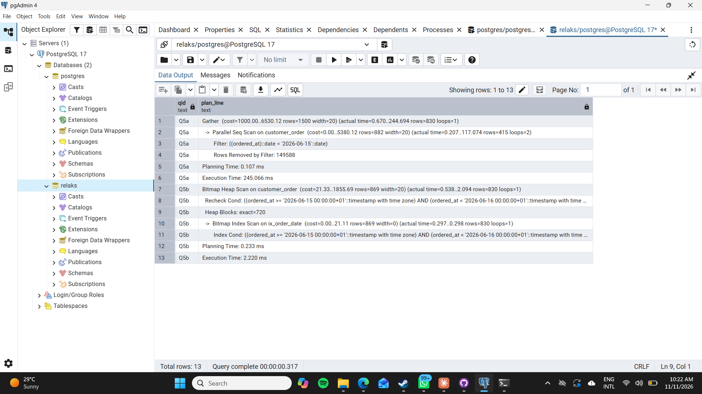

# Portfolio 2 — Query Processing and Optimisation

**Case study:** Relaks (see the [root README](../README.md)). This portfolio uses the same database as Portfolio 1, scaled up to a realistic size, to show how PostgreSQL executes queries and how indexing changes the execution plan.

## Files

| File | What it does |
|---|---|
| `01_generate_data.sql` | Scales the Portfolio 1 database up to 50,008 customers, 300,007 orders, 600,010 order lines, 293,991 payments and 100,011 Reading Club loans (all simulated, reproducible with a fixed random seed) |
| `02_indexes.sql` | The six optimisation indexes, each with the query it was designed for |
| `03_benchmark.sql` | Drops the indexes, times 7 queries and saves their `EXPLAIN ANALYZE` plans, creates the indexes, then times and plans them again. Prints a before/after summary |
| `04_show_plans.sql` | Displays the saved plans for comparison, plus index sizes |
| `screenshots/` | Evidence from my machine |

## How to run

Run the Portfolio 1 scripts first, then:

```bash
psql -U postgres -d relaks -f 01_generate_data.sql
psql -U postgres -d relaks -f 03_benchmark.sql
psql -U postgres -d relaks -f 04_show_plans.sql
```

`03_benchmark.sql` runs each query once to warm the cache, then 5 more times, and records the average. Every plan is captured with `EXPLAIN (ANALYZE, BUFFERS)` into the `perf.plan` table, so the before and after plans can be compared side by side.

## 1. The queries

Every query is a real Relaks operation, not a textbook example.

| ID | Business need | What makes it slow without an index |
|---|---|---|
| Q1 | A customer messages on WhatsApp: "where's my order?" Staff look them up by **phone number** and list their orders, newest first | Full scan of `customer` to find the phone, then a full scan of `customer_order` to find their orders, then a sort |
| Q2 | Black Friday weekend 2025 report: orders and revenue **by sales channel** | Full scan of 300k orders to find ~2.5k in a 3-day window |
| Q3 | Dispatch queue: the 50 **oldest paid orders** waiting for a rider | Full scan of all orders to find the ~3% that are `paid`, then a sort |
| Q4 | Reading Club: **overdue books** not yet returned | Full scan of 100k loans to find the ~3% still out and past their due date |
| Q5a | Orders placed on one day, written as `ordered_at::date = '2026-06-15'` | The function on the column hides it from any index (**non-sargable**) |
| Q5b | The same question written as a range: `ordered_at >= '2026-06-15' AND ordered_at < '2026-06-16'` | Can use an index on `ordered_at` (**sargable**) |
| Q6 | All-time revenue per product | Needs to read almost every order line anyway |

## 2. The indexes and why each one was chosen

| Index | Type | For | Design reasoning |
|---|---|---|---|
| `ix_customer_phone` | B-tree | Q1 | Equality lookup on a high-cardinality column (one phone per customer) |
| `ix_order_customer_date (customer_id, ordered_at DESC)` | Composite B-tree | Q1 | Equality column first, sort column second, so the matching rows come out **already sorted** and the Sort step disappears |
| `ix_order_date (ordered_at)` | B-tree | Q2, Q5b | Range scans on a date column |
| `ix_order_paid_queue (ordered_at) WHERE order_status = 'paid'` | **Partial** | Q3 | Only ~3% of orders are `paid`. Indexing only those rows keeps the index tiny, and it is already in dispatch order |
| `ix_loan_overdue (due_on) WHERE returned_on IS NULL` | **Partial** | Q4 | Only unreturned loans can be overdue. Returned loans (~97%) are left out of the index entirely |
| `ix_item_product_cover (product_id) INCLUDE (quantity, unit_price_at_purchase)` | **Covering** | Q6 | Holds every column Q6 needs, so an index-only scan is *possible* (see the analysis below for what actually happened) |

## 3. Results

Measured on my laptop (Windows, PostgreSQL 17) on 11 November 2026. Each time is the average of 5 runs after 1 warm-up run.

| Query | Before (ms) | After (ms) | Times faster | Index used after |
|---|---:|---:|---:|---|
| Q1 WhatsApp phone lookup | 172.98 | 3.65 | **47.4×** | `ix_customer_phone` + `ix_order_customer_date` |
| Q2 Black Friday revenue by channel | 333.53 | 199.43 | 1.7× | `ix_order_date` (orders only) |
| Q3 Dispatch queue | 170.49 | 0.32 | **532.8×** | `ix_order_paid_queue` (partial) |
| Q4 Overdue Reading Club books | 56.43 | 37.24 | 1.5× | `ix_loan_overdue` (partial) |
| Q5a One day, non-sargable | 218.84 | 199.34 | 1.1× | none, index cannot be used |
| Q5b One day, sargable range | 188.64 | 3.34 | **56.5×** | `ix_order_date` |
| Q6 All-time product revenue | 660.06 | 588.82 | 1.1× | none, sequential scan is still cheapest |

Row counts after loading the data:





## 4. Execution plans

**Q3: partial index.** Before, PostgreSQL runs a Parallel Seq Scan over every order, removes 145,486 rows with the filter, sorts what is left, and only then takes the first 50 (172 ms). After, it walks the small partial index, which is already in `ordered_at` order, and stops after 50 rows (`Limit`). No sort and no full scan, **0.054 ms**.



**Q5a vs Q5b: sargability.** Both queries ask the same question and both ran *after* `ix_order_date` existed. Q5a still does a Parallel Seq Scan, removing 149,588 rows (245 ms), because `ordered_at::date` is a computed value that the index does not store. Q5b expresses the same day as a range on the raw column and uses a Bitmap Index Scan on `ix_order_date` (2.2 ms). Both return the same 830 rows. **The index alone is not enough; the query has to be written so the planner can use it.**



## 5. Performance analysis

**1. Indexes give the biggest wins when the query is selective.** Q1, Q3 and Q5b each need a tiny fraction of a large table: one customer's orders, the ~3% of orders that are `paid`, or one day out of 365. That's where indexing turned a full scan into a direct lookup, making them 47–533× faster. The biggest win came from the **partial** index in Q3. Because it stores only `paid` orders, already in date order, PostgreSQL reads exactly 50 index entries and stops.

**2. The index alone is not enough; the query has to be written to use it.** Q5a and Q5b ask the identical question. Wrapping the column in a function (`ordered_at::date`) made Q5a non-sargable, so it ignored `ix_order_date` and stayed at ~200 ms. Rewriting it as a range made it 56× faster. In the Relaks app, date filters should always be written as ranges.

**3. When one step gets faster, the bottleneck moves.** In Q2 the date index replaced the full scan of `customer_order` with an index lookup. Overall, though, Q2 only improved 1.7×, because the plan still hash-joins against a full sequential scan of the 600,010 `order_item` rows, and that scan is now the slowest step. Q4 behaves the same way: the partial index finds the overdue loans quickly, but the join to `rental_subscription` still scans that table. The next optimisation would target those join steps, not the filters that are already indexed.

**4. Some queries should not be "fixed" with an index.** Q6 needs almost every order line, so a sequential scan is genuinely the cheapest plan. The planner correctly ignored the covering index, and the ~10% difference is run-to-run noise. For a report like this the better solution is a **materialised view** refreshed nightly, not another index.

**5. Indexes have a cost.** Every index slows down `INSERT`/`UPDATE` slightly and uses disk space. Relaks is read-heavy (customers browsing, staff looking up orders) with a modest number of orders per day, so six targeted indexes are a good trade. The partial indexes are the cheapest to maintain, because only `paid` orders and unreturned loans are stored in them (query D in `04_show_plans.sql` shows the sizes).

**6. The planner's estimates are not always exact.** For Q3 the planner estimated 5,406 matching rows per parallel process before the index, but each process actually returned 4,518. Running `ANALYZE` after loading the data matters, because the plan choices depend on these estimates.

## 6. Evidence

1. `01-data-generated.png`: row counts after `01_generate_data.sql`
2. `02-benchmark-summary.png`: before/after timings for all 7 queries
3. `03-plan-q3.png`: Q3 plan before and after the partial index
4. `04-plan-q5.png`: Q5a (non-sargable) vs Q5b (sargable) plans
