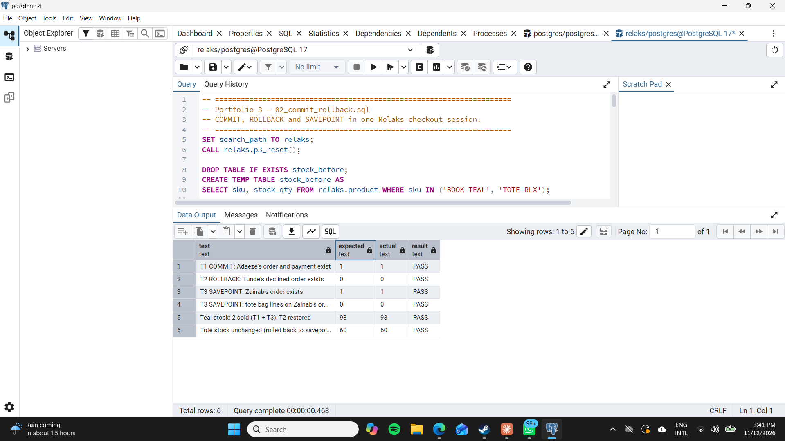
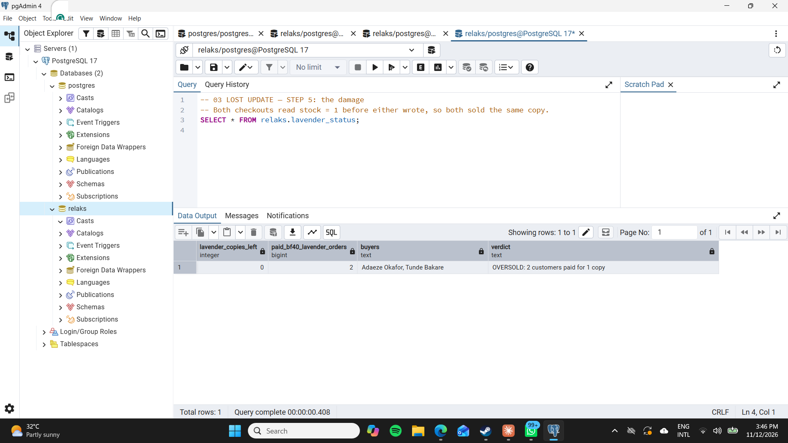
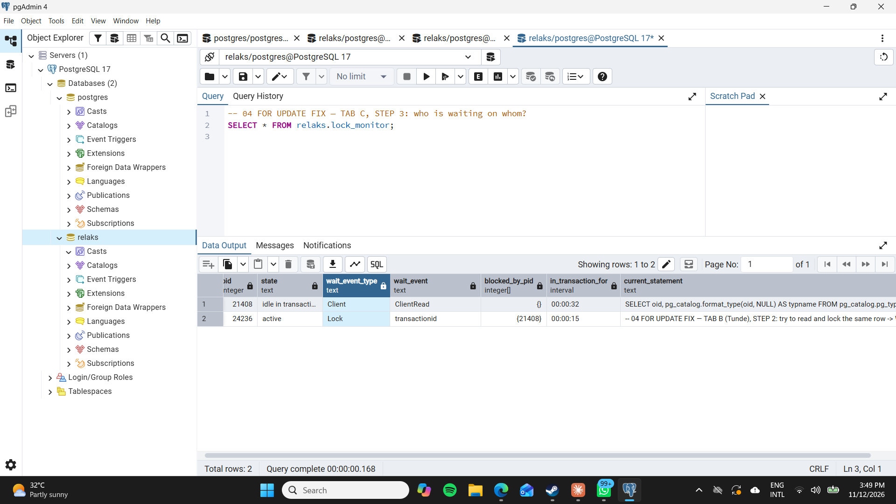
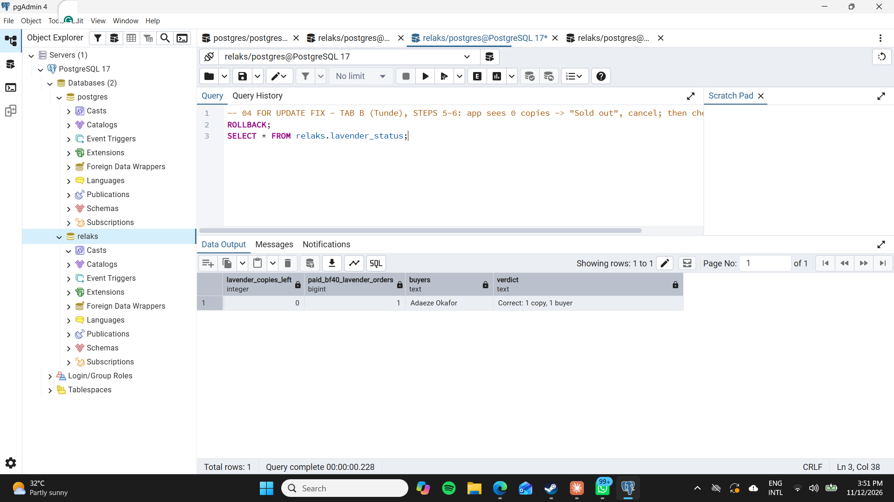
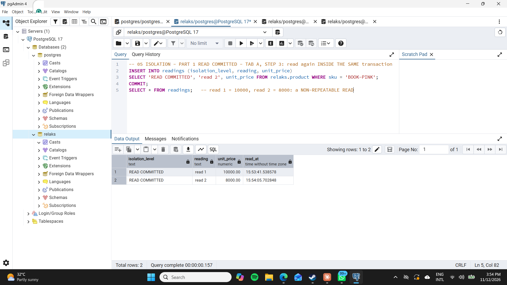
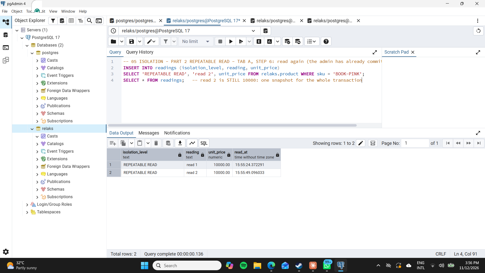
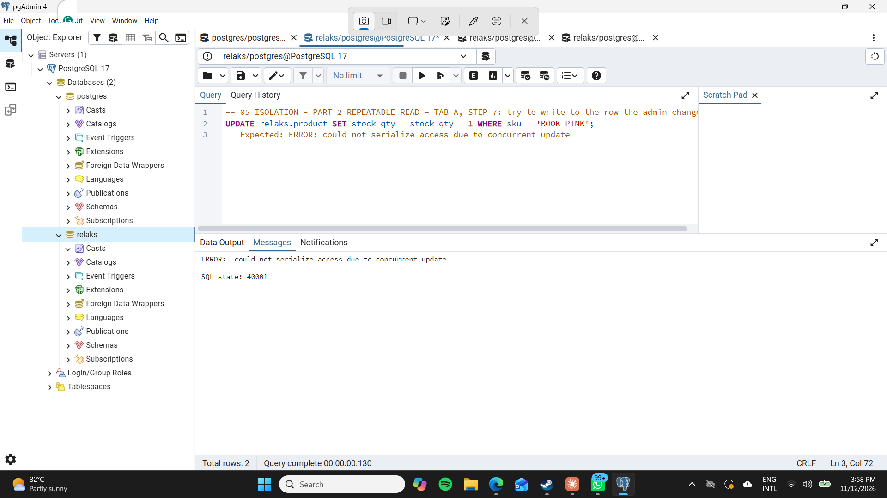
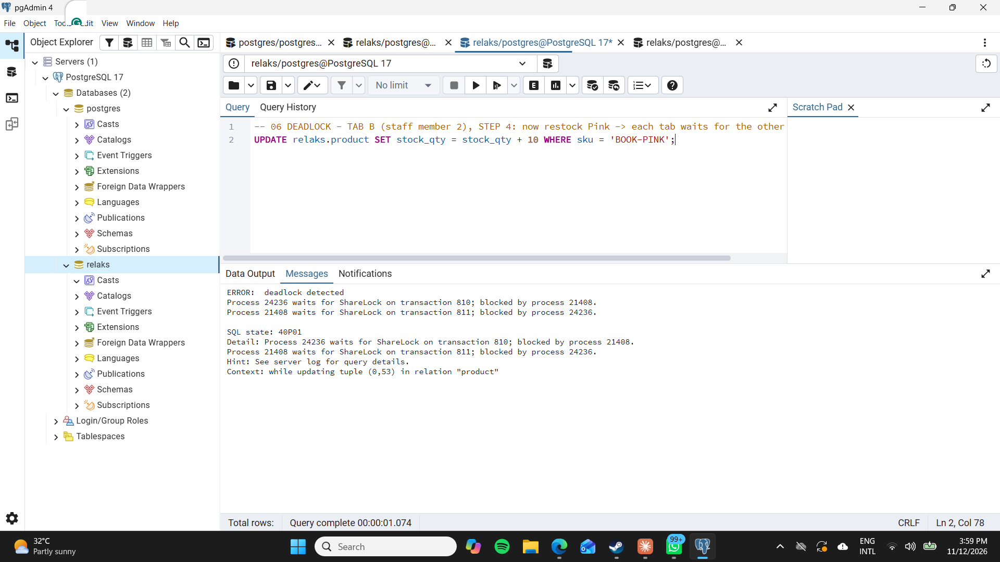

# Portfolio 3 — Transactions and Concurrency

**Case study:** Relaks (see the [root README](../README.md)), using the same database as Portfolios 1–2.

**Scenario:** the Relaks **Black Friday finale** (promo `BF40`, 40% off). Hundreds of customers are checking out at the same moment, and there is **one Lavender Edition copy left**. This is the real situation where transactions and concurrency control stop being theory: oversell that copy and Relaks has taken money for a book it cannot deliver.

## Files

| File | What it shows | How to run |
|---|---|---|
| `01_setup.sql` | Helpers: `p3_reset()` (restores the starting state), `p3_create_order()` (the checkout's order + line + Paystack payment), `lavender_status` (how many copies are left vs how many people paid), `lock_monitor` (who is waiting on whom) | Once, any tab |
| `02_commit_rollback.sql` | **COMMIT, ROLLBACK, SAVEPOINT** | Whole file in one tab |
| `03_lost_update_problem.sql` | **The concurrency problem:** two customers buy the last copy | Step by step, Tabs A and B |
| `04_select_for_update_fix.sql` | **The control mechanism:** row locking with `SELECT … FOR UPDATE` | Step by step, Tabs A, B and C |
| `05_isolation_levels.sql` | **Isolation:** READ COMMITTED vs REPEATABLE READ | Step by step, Tabs A and B |
| `06_deadlock.sql` | **Deadlock detection** | Step by step, Tabs A and B |

The two-customer scripts need two separate database sessions at the same time. In pgAdmin, each Query Tool tab is its own session, so Tab A plays Adaeze's checkout and Tab B plays Tunde's. Every step in the scripts is labelled with the tab it runs in.

## 1. COMMIT, ROLLBACK and SAVEPOINT (`02_commit_rollback.sql`)

A Relaks checkout is several writes that only make sense **together**: reduce the stock, create the order, add the order line, record the Paystack payment.

| Transaction | What happens | Outcome |
|---|---|---|
| **T1 COMMIT** | Adaeze buys a Teal Edition; all four writes succeed | `COMMIT` makes them permanent together |
| **T2 ROLLBACK** | Tunde's checkout does the same four writes, then Paystack declines his card | `ROLLBACK` undoes **all four**. No half-made order, no "ghost" payment row, and the stock goes back up |
| **T3 SAVEPOINT** | Zainab buys a Teal Edition, adds a tote bag, then removes it before paying | `ROLLBACK TO SAVEPOINT add_tote_bag` undoes **only** the tote bag (its order line and stock change). The rest of the order is committed |

The script ends by checking itself: 6 tests compare the expected and actual state of the database.

**ACID link:** T1 and T2 demonstrate **atomicity** (all or nothing). T3 shows that atomicity can be applied to *part* of a transaction. Once T1 and T3 are committed, PostgreSQL's write-ahead log guarantees their **durability**.

## 2. The concurrency problem: a lost update (`03_lost_update_problem.sql`)

The checkout reads the stock, decides in the application that a copy is available, then writes back the stock it calculated (`1 − 1 = 0`).

| Step | Tab A (Adaeze) | Tab B (Tunde) |
|---|---|---|
| 1 | `BEGIN`; reads stock → **1** | |
| 2 | | `BEGIN`; reads stock → **1** |
| 3 | sets stock to 0, creates order, `COMMIT` | |
| 4 | | sets stock to 0, creates order, `COMMIT`, **with no error** |

Both customers paid for the single copy. Tunde's write simply overwrote Adaeze's, so her decrement was **lost**. PostgreSQL did nothing wrong. Under its default **READ COMMITTED** isolation, each statement sees committed data and nothing stops two transactions acting on the same earlier reading. The bug is in the read-then-write pattern.

## 3. The fix: pessimistic locking with `SELECT … FOR UPDATE` (`04_select_for_update_fix.sql`)

The only change is reading the stock with `FOR UPDATE`, which places a **row-level lock** on the Lavender row for the rest of the transaction.

| Step | Tab A (Adaeze) | Tab B (Tunde) |
|---|---|---|
| 1 | `SELECT … FOR UPDATE` → **1**, row locked | |
| 2 | | `SELECT … FOR UPDATE` → **waits** |
| 4 | decrements stock, creates order, `COMMIT` (lock released) | wait ends, sees **0** |
| 5 | | app shows "Sold out", `ROLLBACK` |

While Tunde was waiting, a third tab queried `pg_stat_activity` through the `lock_monitor` view. His session (pid 24236) is `active` with `wait_event_type = Lock` and `wait_event = transactionid`, and `pg_blocking_pids()` names Adaeze's session (pid 21408) as the blocker. Adaeze's session is `idle in transaction`: it holds the lock while it waits for her next command. (Its `current_statement` shows a catalogue query that pgAdmin itself sends in the background. That column shows the last statement the session ran, not the one holding the lock.)

When Adaeze committed, Tunde's `SELECT … FOR UPDATE` finished (after waiting more than 3 minutes while I took the screenshot) and returned **0**. His checkout then rolled back as "Sold out". Result: one copy, one buyer.

**Alternative without an explicit lock:** combine the check and the write into one atomic statement, `UPDATE product SET stock_qty = stock_qty - 1 WHERE sku = 'BOOK-LAV' AND stock_qty >= 1 RETURNING stock_qty;`. Zero rows returned means sold out. The `CHECK (stock_qty >= 0)` constraint from Portfolio 1 is the final safety net.

## 4. Isolation levels (`05_isolation_levels.sql`)

A finance report (Tab A) reads the Pink Edition price twice in one transaction. Meanwhile the admin (Tab B) applies the Black Friday price, cutting it from ₦10,000 to ₦8,000. The report saves each reading, with the time, into a temporary table, so one result grid shows both readings side by side.

| | Read 1 | Admin changes price | Read 2 | Then the report tries to write the same row |
|---|---|---|---|---|
| **READ COMMITTED** | ₦10,000 | commits | **₦8,000** (non-repeatable read) | n/a |
| **REPEATABLE READ** | ₦10,000 | commits | **₦10,000** (same snapshot) | **ERROR: could not serialize access due to concurrent update** |

- **READ COMMITTED** (PostgreSQL's default) takes a fresh snapshot for **every statement**. It is fast and fine for single-statement work, but a multi-step report can mix old and new data.
- **REPEATABLE READ** takes **one snapshot for the whole transaction**, so the report is internally consistent. If the transaction then tries to update a row that someone else changed after the snapshot, PostgreSQL refuses rather than allow a lost update. The application must catch the error and retry.
- **SERIALIZABLE** goes further and also detects read/write dependency cycles. That is useful for money movements such as the Reading Club revenue split, at the cost of more retries.

**Something that went wrong while I ran this (and what it taught me).** On my first attempt at Part 1, I ran the reset and `BEGIN` together in one go. pgAdmin sends everything you run as a single request. When that request contains a `BEGIN`, PostgreSQL folds the statements before it into the same transaction. So the reset's `UPDATE` on the Pink row became part of the report's open transaction, and it held a row lock. The admin's price change in Tab B then simply **waited**, instead of demonstrating the non-repeatable read. I found the cause with `lock_monitor` and cancelled the waiting query with `pg_cancel_backend()`. Then I re-ran the reset on its own before `BEGIN`. The lesson for the real Relaks app: be explicit about where every transaction starts and ends, because a write that sneaks into a long transaction holds its locks for the whole time.

## 5. Deadlock detection (`06_deadlock.sql`)

Two staff restock Pink and Teal at the same time, but in opposite order. Tab A locks Pink and then wants Teal, while Tab B locks Teal and then wants Pink. Each waits for the other forever, so PostgreSQL's deadlock detector (after `deadlock_timeout`, 1 s) aborts one transaction. That releases its lock, and the other transaction completes.

In my run, PostgreSQL aborted Tab B (pid 24236) with `ERROR: deadlock detected` (SQL state 40P01). The detail lines show the cycle: 24236 was blocked by 21408, and 21408 was blocked by 24236. Tab A's waiting `UPDATE` then went through, and it committed.

**Prevention:** always lock rows in a consistent order (for example by `product_id`), so two transactions can never wait for each other in a circle.

## 6. What I would use in the real Relaks checkout

| Situation | Choice | Why |
|---|---|---|
| Buying stock-limited items (Black Friday, last copies) | `SELECT … FOR UPDATE`, or the single atomic `UPDATE … WHERE stock_qty >= 1` | Prevents overselling. The lock is held only for the few milliseconds of checkout |
| Paystack webhooks | One transaction per webhook, plus the `UNIQUE` Paystack reference from Portfolio 1 | A failed webhook rolls back cleanly, and a retried webhook cannot be applied twice |
| Finance and revenue-split reports | `REPEATABLE READ` | Every figure in the report comes from the same moment in time |
| Default for everything else | `READ COMMITTED` | Lowest overhead, and correct for single-statement operations |

## 7. Evidence

All screenshots were taken on my laptop (PostgreSQL 17, pgAdmin 4).

1. `01-commit-rollback.png`: 6/6 transaction checks pass
2. `02-lost-update.png`: OVERSOLD, 2 customers paid for 1 copy
3. `03-lock-wait.png`: Tunde's session waiting on Adaeze's row lock
4. `04-for-update-result.png`: correct, 1 copy and 1 buyer
5. `05-read-committed.png`: non-repeatable read (₦10,000, then ₦8,000)
6. `06-repeatable-read-snapshot.png`: both readings ₦10,000 from one snapshot
7. `07-serialization-error.png`: could not serialize access (SQL state 40001)
8. `08-deadlock.png`: deadlock detected (SQL state 40P01)
