# Portfolio 4 — NoSQL: Relaks in MongoDB

**Case study:** the same Relaks business and the same simulated data as Portfolios 1–3 (same customers, products, prices, promo codes and Reading Club books), redesigned as a **document database**.

**Platform:** MongoDB Atlas, free M0 cluster "Relaks" (MongoDB 8.0, AWS, 3-node replica set), database `relaks`. All work was done in **Atlas Data Explorer**, the web version of MongoDB Compass.

## Files

| File | What it contains |
|---|---|
| `01_collections_and_validation.js` | The four collections and their **JSON Schema validators**, plus a test document that must be rejected |
| `02_queries.js` | Finds and **aggregation pipelines** answering real Relaks questions, including a `$lookup` join |
| `03_indexes_and_explain.js` | Compound, multikey and **unique** indexes, measured with `explain()` before and after |
| `04_atomic_updates.js` | The "last Lavender copy" problem from Portfolio 3, solved with a single atomic conditional update |
| `data/*.json` | The dataset in MongoDB Extended JSON: 200 customers, 8 products, 6 books and 1,507 orders |
| `tools/generate_data.js` | The seeded generator that produced `data/*.json`. The same code ran in the Atlas page to insert the documents, so the files and the database are identical |

All customer names, emails, phones and streets are fictional.

## 1. From tables to documents

Portfolio 1 normalised Relaks into 16 tables. A document database is designed the other way round: **start from how the application reads the data, and keep together what is read together.**

| Collection | Docs | What is embedded | What is referenced |
|---|---|---|---|
| `orders` | 1,507 | Line items, delivery address, promo, every Paystack payment attempt, delivery status, and a **snapshot** of the customer's name and phone | `customer.customer_id` → `customers._id` |
| `customers` | 200 | Saved addresses, and Reading Club subscriptions with their loans | `loans.book_id` → `books._id` |
| `products` | 8 | Combo contents; category-specific `attributes` | — |
| `books` | 6 | — | — |

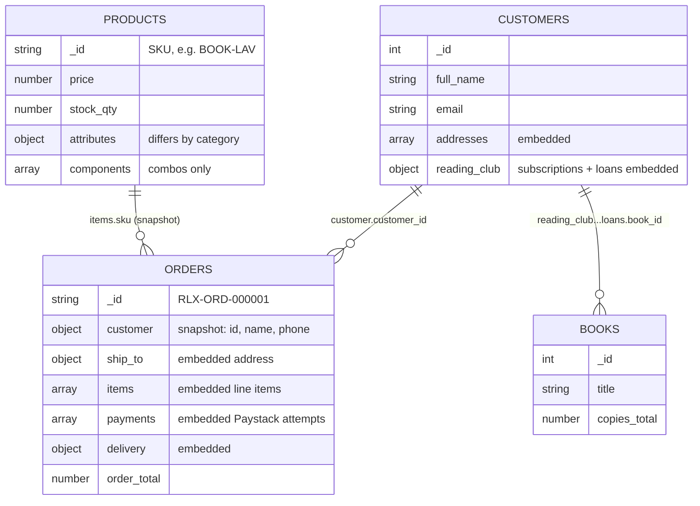

**Design decisions, and why:**

- **Orders embed their line items, payments and delivery.** These have no life outside the order, are always shown together on the order page and on receipts, and are bounded in size (a few items, a few payment attempts). In PostgreSQL, the same page needed `customer_order` + `order_item` + `payment` + `delivery` + `address`: one document read replaces a 5-table join.
- **Orders keep a snapshot of the customer and the prices.** The name, phone, delivery address and `unit_price` are copied at checkout. This is deliberate denormalisation. A receipt must show what was true *when the customer paid*, the same reason Portfolio 1 stored `unit_price_at_purchase`. Its cost is that the snapshot is not updated if Adaeze later changes her phone number, which is correct for a receipt.
- **Customers embed addresses and Reading Club history.** A customer has a handful of addresses and a few subscriptions per year, so the arrays stay small. The validator caps addresses at 10.
- **Books and products stay separate collections.** Many orders and loans point to the same product or book, and stock and copy counts must exist in **one** place, otherwise every order would need updating when stock changes.
- **Flexible schema where Relaks actually needs it.** Coloring books have `edition`, `pages` and `paper`; pens have `count` and `washable`; combos have a `components` array. In SQL that is either NULL-filled columns or extra tables. Wanjiru (Kenya) simply has `addresses: []`.

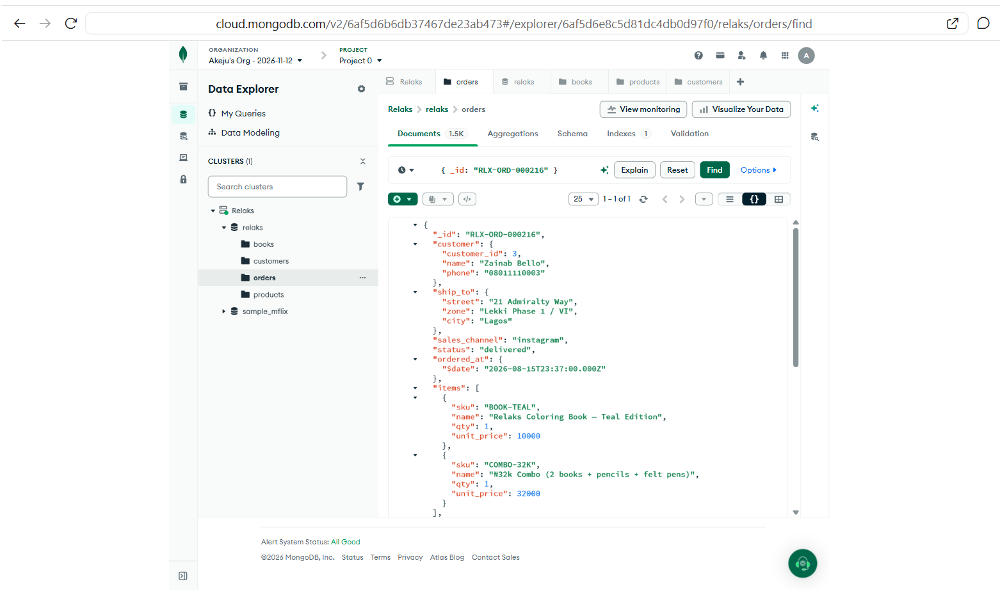

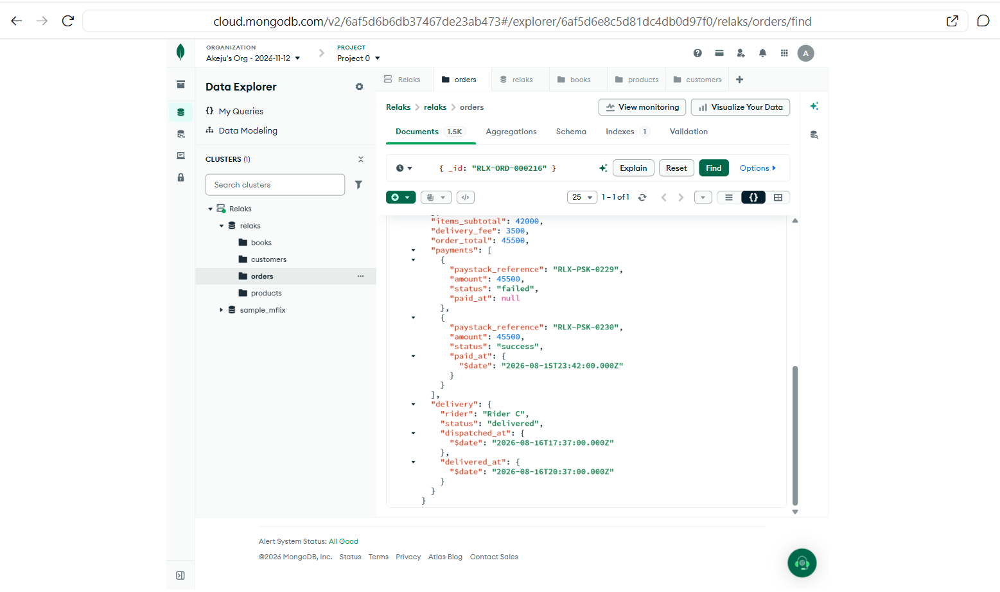

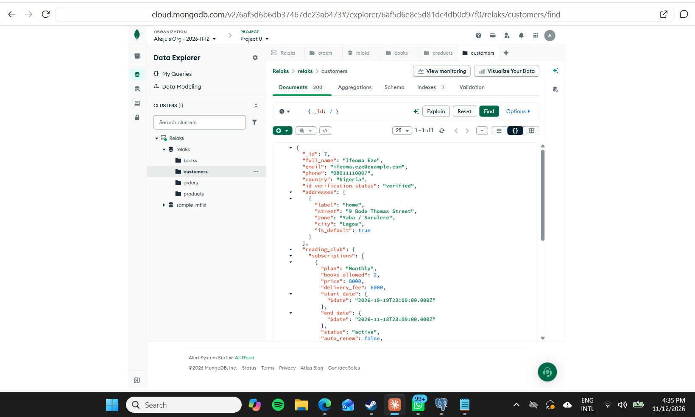

## 2. Keeping the data valid without a fixed schema

"Schemaless" does not have to mean "anything goes". Each collection has a **JSON Schema validator** (Action: Error, Level: Strict). This is MongoDB's version of Portfolio 1's `NOT NULL` and `CHECK` constraints:

| Rule | PostgreSQL (Portfolio 1) | MongoDB (`$jsonSchema`) |
|---|---|---|
| Sales channel is one of 5 | `CHECK (sales_channel IN (...))` | `sales_channel: { enum: [...] }` |
| An order has at least one item | `order_item` rows (enforced by the app) | `items: { minItems: 1 }` |
| Money is never negative | `CHECK (... >= 0)` | `minimum: 0` |
| Stock never goes below 0 | `CHECK (stock_qty >= 0)` | `stock_qty: { minimum: 0 }` |

The test order (`RLX-ORD-TEST-BAD`) was **rejected** with "Document failed validation". MongoDB listed all three problems: channel "facebook" not in the enum, `items` empty, and `order_total` −500.

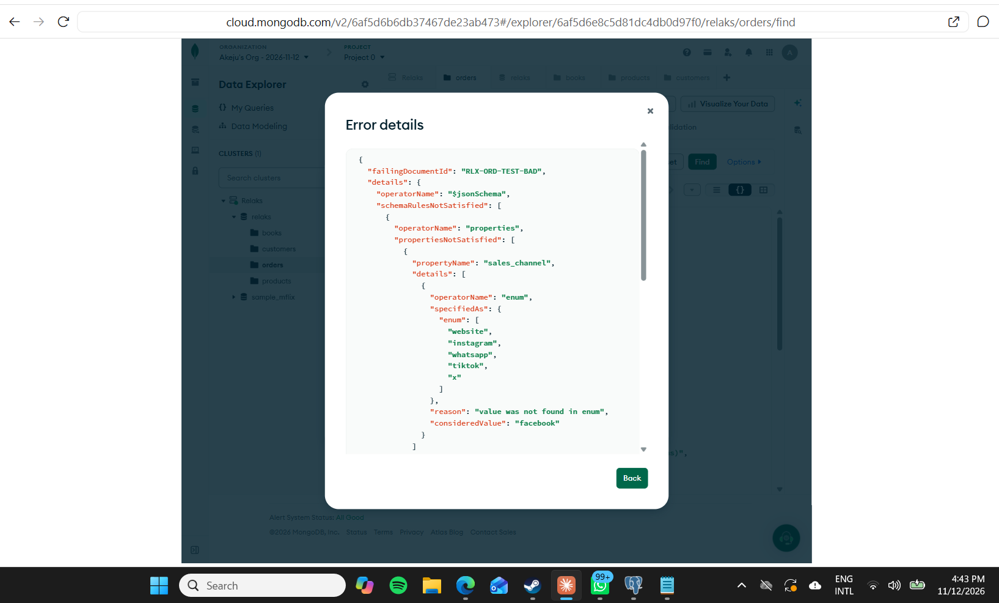

## 3. Queries and aggregation

**Revenue by product** (`02_queries.js`, Q5). `$unwind` turns each line item into its own row, and `$group` totals them. Paid, dispatched and delivered orders only:

| SKU | Units sold | Revenue (₦) |
|---|---|---|
| COMBO-32K | 296 | 9,472,000 |
| COMBO-25K | 310 | 7,750,000 |
| BOOK-LAV | 331 | 3,310,000 |
| BOOK-TEAL | 316 | 3,160,000 |
| BOOK-PINK | 313 | 3,130,000 |
| TOTE-RLX | 337 | 2,696,000 |
| FELT-24 | 305 | 1,525,000 |
| PENCIL-24 | 307 | 1,228,000 |

The two combos earn more than all three single books put together, so they are the products to push in the Black Friday finale.

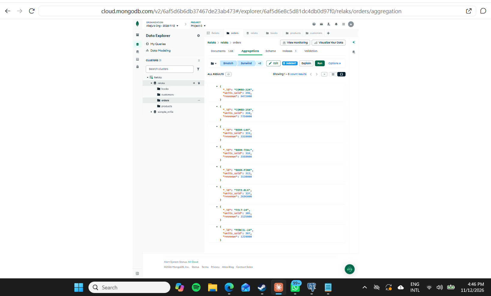

**Reading Club availability** (Q7). Loans live inside customer documents, while the book catalogue is its own collection, so this pipeline uses **`$lookup`**, MongoDB's join:

| Book | Copies owned | On loan | Available |
|---|---|---|---|
| Atomic Habits | 5 | 5 | 0 |
| Born a Crime | 2 | 2 | 0 |
| Purple Hibiscus | 3 | 3 | 0 |
| Stay With Me | 2 | 2 | 0 |
| The Psychology of Money | 3 | 3 | 0 |
| Things Fall Apart | 4 | 2 | 2 |

Five of the six titles are fully lent out. Relaks needs more copies before it takes on more Reading Club members.

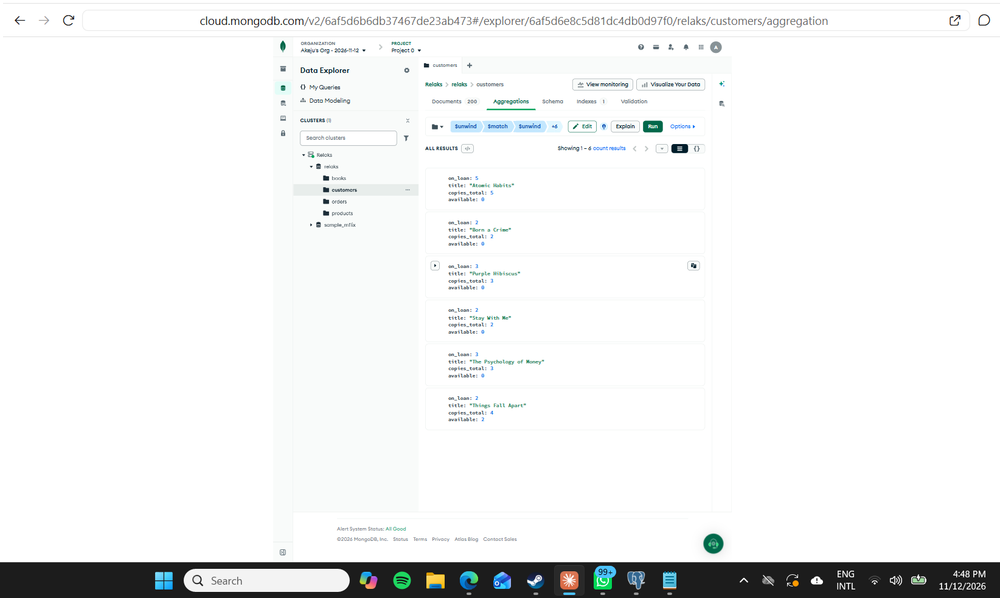

`02_queries.js` also has orders where a card was declined and then retried (querying *inside* the `payments` array), a low-stock alert, monthly sales by channel, and daily Black Friday week 1 performance.

## 4. Indexes and execution plans

**Query:** "My orders" for customer 1, newest first: `find({ "customer.customer_id": 1 }).sort({ ordered_at: -1 })`.

| | Before | After `customer_orders_newest` |
|---|---|---|
| Plan | `COLLSCAN` → `SORT` | `IXSCAN` → `FETCH` |
| Documents examined | **1,507** | **19** |
| Index keys examined | 0 | 19 |
| Sorted in memory | Yes | **No** |
| Documents returned | 19 | 19 |

The compound index `{ "customer.customer_id": 1, ordered_at: -1 }` puts the equality field first and the sort field second, so MongoDB reads exactly this customer's orders, already in date order. That is the same rule as the composite B-tree index in Portfolio 2. With only 1,507 orders both versions run in about 1 ms, so the useful measure is the work done (1,507 vs 19 documents), which grows with the data.

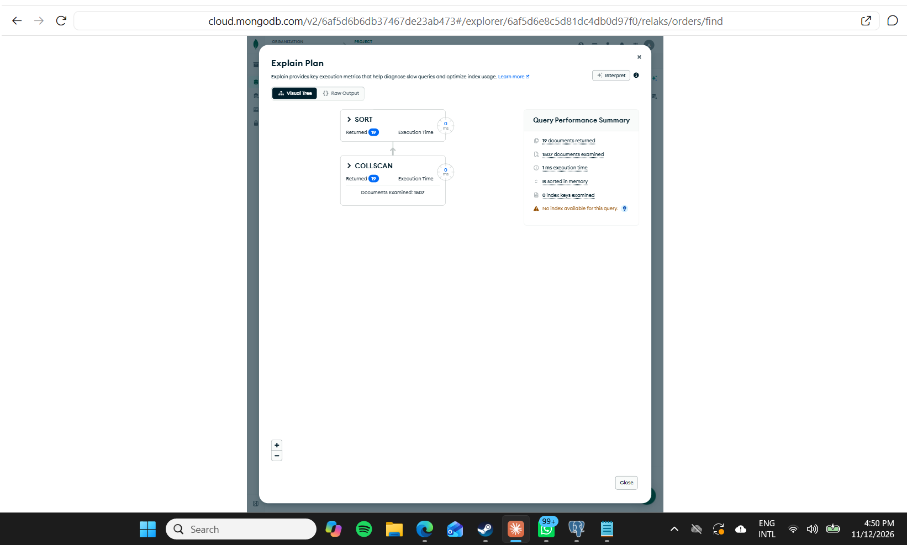

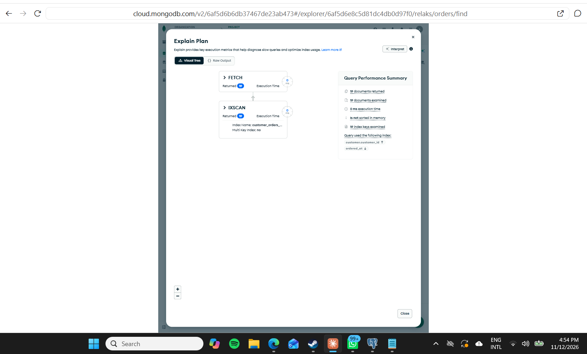

**Unique index on an embedded array.** `unique_paystack_reference` on `payments.paystack_reference` is a *multikey* index (one key per payment attempt), with `unique: true` and a partial filter so that unpaid orders with no payments are left out. It does the job of Portfolio 1's `UNIQUE` constraint: a retried Paystack webhook cannot record the same payment twice. Inserting a new order that reused `RLX-PSK-0001` failed with **E11000 duplicate key error**.

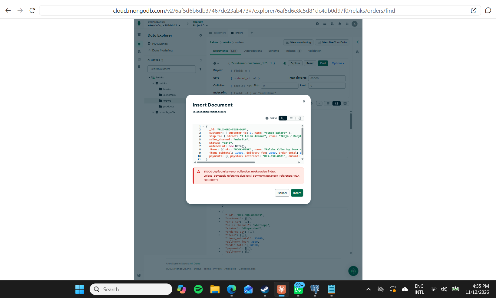

## 5. Concurrency: the last Lavender copy, the MongoDB way

Portfolio 3 needed `SELECT … FOR UPDATE` to stop two customers buying the last copy. In MongoDB, **every write to a single document is atomic**, so the stock check and the decrement can be one conditional update:

```js
db.products.updateOne(
  { _id: "BOOK-LAV", stock_qty: { $gte: 1 } },   // only if a copy is left
  { $inc: { stock_qty: -1 } }
)
```

Run three times, it took the stock from 3 to 0. The fourth attempt matched **0 documents**, so the app shows "Sold out". No lock, no lost update, and the validator's `minimum: 0` is a second safety net, like the `CHECK` in Portfolio 1.

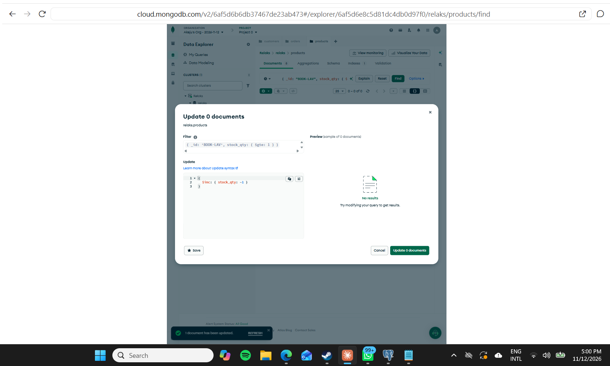

A real checkout touches **two** collections: decrease stock in `products` and insert into `orders`. That needs a **multi-document transaction**. MongoDB supports these on replica sets, and every Atlas cluster is one, but they must be started from a driver or mongosh session. A sketch is in `04_atomic_updates.js`; it was not run here, because Data Explorer has no shell.

## 6. Is MongoDB suitable for Relaks?

| Relaks need | Fit | Why |
|---|---|---|
| Order pages, receipts, order history | **Good** | One document per order: one read, no joins, and the snapshot keeps receipts accurate |
| Product catalogue with different kinds of product | **Good** | Each category carries its own attributes; adding a new product type needs no migration |
| Customer profile + Reading Club history | **Good** | One read for the whole profile page |
| Growth (more orders, more channels) | **Good** | Documents spread easily across shards (see Portfolio 5); Atlas scales without the app changing |
| Stock for one product (last copies) | **Good** | Single-document atomic updates, shown above |
| Checkout across stock + order + payment | **Weaker** | Needs multi-document transactions; PostgreSQL does this natively and more simply |
| Integrity between collections | **Weaker** | No foreign keys: nothing stops a loan pointing to a book that does not exist, or more loans than copies. The application must check |
| Finance reports across everything | **Weaker** | Possible with aggregation, but SQL joins and `GROUP BY` are clearer, and the denormalised snapshots must be kept in mind |

**Recommendation: use both.** PostgreSQL (Portfolios 1–3) stays the **system of record** for money and stock: payments, stock levels and the checkout transaction, where foreign keys, `CHECK` constraints and ACID transactions matter most. MongoDB suits the **read-heavy, flexible** parts: the product catalogue, order history and receipts, customer profiles, and future features such as reviews or Instagram and WhatsApp message logs, whose shape changes often. This is a *polyglot persistence* design. The cost is keeping the two in sync, for example by copying each completed order from PostgreSQL to MongoDB.

## 7. Evidence

All screenshots are from Atlas Data Explorer on my account (cluster "Relaks", database `relaks`).

1. `01-order-document-top.png`: an order as one document (customer, address, items)
2. `02-order-document-payments.png`: the same order's two payment attempts and delivery
3. `03-customer-document.png`: customer with embedded addresses and Reading Club
4. `04-validation-error.png`: invalid order rejected by the JSON Schema validator
5. `05-aggregation-revenue-by-product.png`: revenue by product
6. `06-aggregation-reading-club-lookup.png`: `$lookup` join, Reading Club availability
7. `07-explain-before-index.png`: COLLSCAN, 1,507 documents examined
8. `08-explain-after-index.png`: IXSCAN, 19 documents examined
9. `09-unique-paystack-reference.png`: E11000 duplicate Paystack reference
10. `10-atomic-stock-update.png`: fourth buyer matches 0 documents (sold out)
