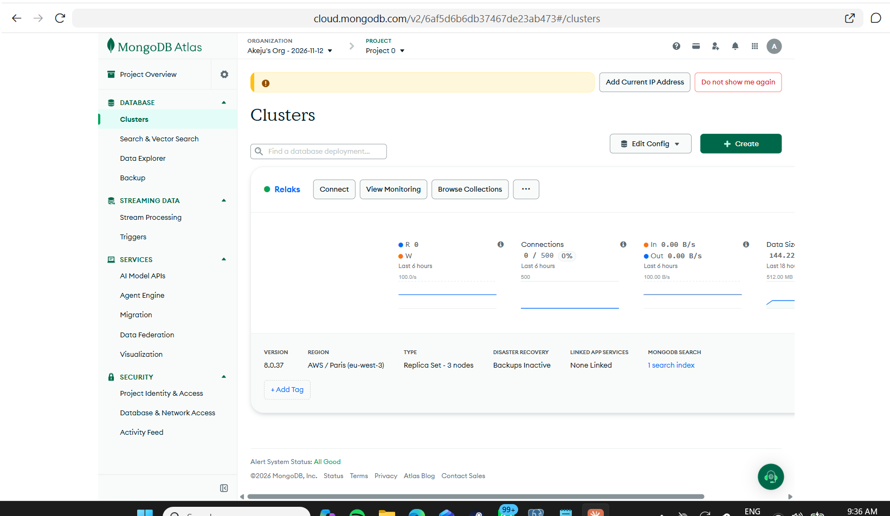
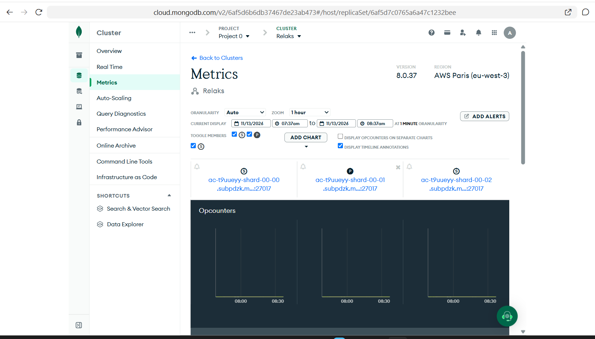
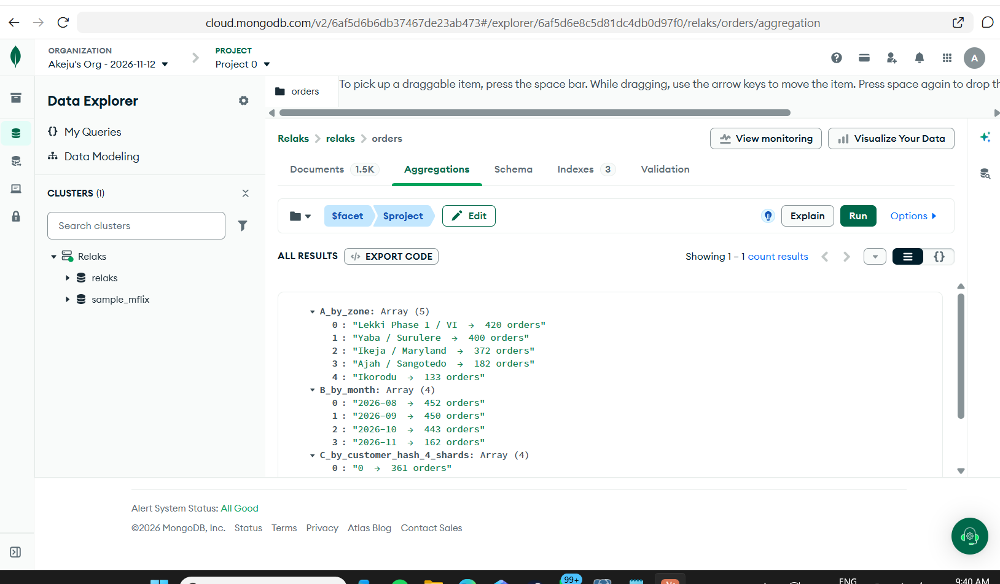
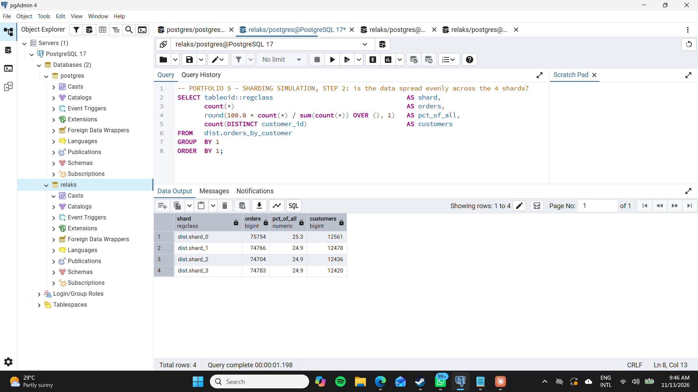
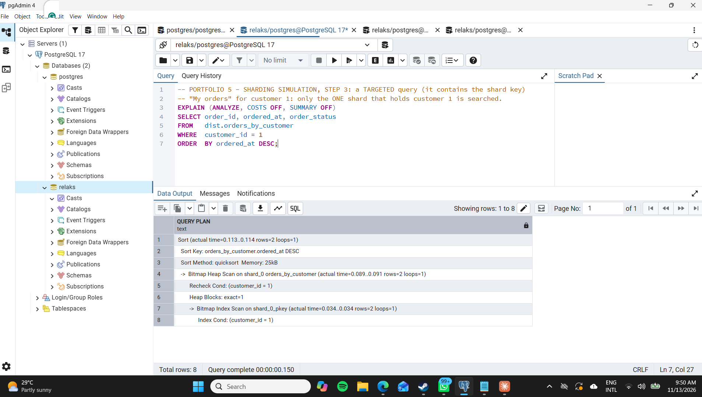
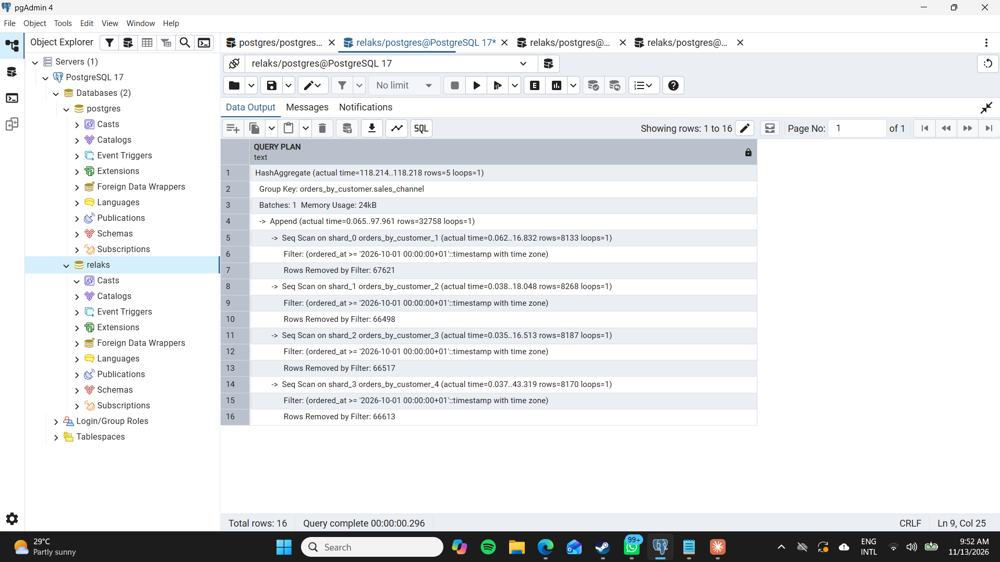
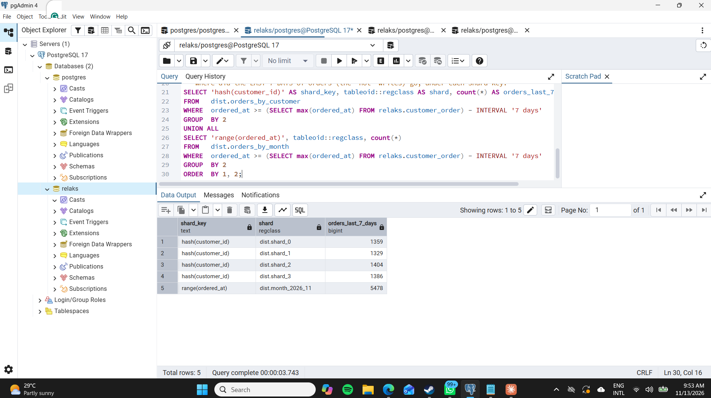
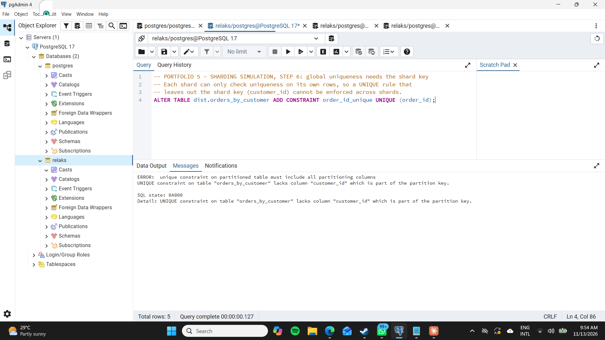
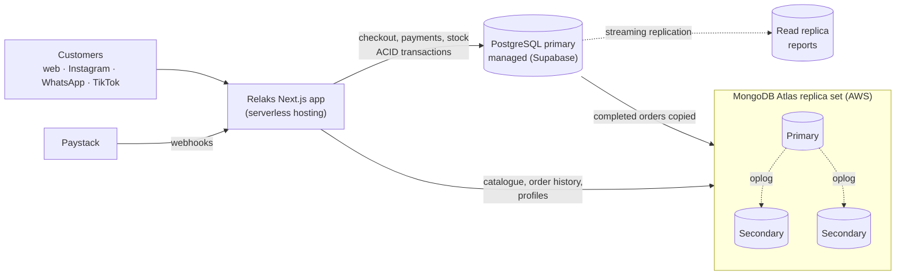

# Portfolio 5 — Distributed and Cloud Databases

**Case study:** Relaks again. Today it runs on a single database. This portfolio asks what happens as Relaks grows (more orders, more cities, Black Friday spikes), and shows how **replication**, **sharding**, **availability**, **consistency** and **cloud deployment** would apply, using real evidence from:

- the **MongoDB Atlas** cluster built in Portfolio 4 (a real 3-member replica set in the cloud), and
- the **PostgreSQL** database from Portfolios 1–3, where 300,000 orders were split into 4 "shards" to test shard-key choices.

## Files

| File | What it contains |
|---|---|
| `01_sharding_simulation.sql` | Splits the 300,000 Portfolio 2 orders into 4 hash shards and 13 monthly range shards, then tests spread, targeted vs scatter-gather queries, hotspots and uniqueness. It works on copies in a `dist` schema and removes them at the end |
| `02_shard_key_analysis.js` | Atlas aggregation (`$facet`) comparing three possible shard keys on the 1,507 MongoDB orders |
| `03_replication_and_consistency.js` | Write concern, read concern, read preference and causally consistent sessions, chosen per Relaks operation |

## 1. Replication and availability (MongoDB Atlas)

The Relaks cluster in Atlas is a **replica set of 3 members** in AWS Paris (eu-west-3), running MongoDB 8.0.

The monitoring page shows the three members. `shard-00-01` is the **primary (P)**; `shard-00-00` and `shard-00-02` are **secondaries (S)**.

**How it works:**

- **Every write goes to the primary.** It records the change in its *oplog* (operation log), and the two secondaries copy and replay that log, so all three hold the same data a moment later.
- **If the primary fails** (hardware fault, data-centre problem, or Atlas patching the server), the secondaries notice the missing heartbeats and hold an **election**. One of them becomes the new primary; MongoDB documents the typical election time as under 12 seconds. Atlas connection strings use `retryWrites=true`, so the driver retries an interrupted write on the new primary. A Relaks customer would see at most a short delay at checkout, not an error.
- **Why 3 members, not 2:** an election needs a **majority** (2 of 3). With 2 members, losing one leaves no majority, so no primary can be elected and writes stop. 3 is the smallest set that survives one failure.
- **Availability vs the single PostgreSQL server in Portfolios 1–3:** if that one server goes down, Relaks is down until it is repaired or restored. The replica set turns most failures into a brief pause.

## 2. Consistency: choosing per operation

A replicated database lets each operation choose how up to date its data must be. For Relaks, the choice follows the money:

| Relaks operation | Setting | Why |
|---|---|---|
| Record a Paystack payment | Write concern `w: "majority"` | Acknowledged only after 2 of 3 members have it, so a failover can never roll back a payment the customer was told succeeded |
| Check stock at checkout (last Lavender copy) | Read the **primary**, read concern `"majority"` | Must see the latest committed stock, otherwise two customers could buy the same copy (Portfolio 3's lost update, in a distributed form) |
| "My orders" straight after paying | **Causally consistent session** | Read-your-own-writes: the customer always sees the order they have just placed, even if the read goes to a secondary |
| Product catalogue, Reading Club list | Read preference `secondaryPreferred` | Data a few seconds old is fine. This takes read load off the primary during Black Friday |
| Finance and sales reports | Read preference `secondary`, `maxStalenessSeconds: 90` | Heavy aggregations run on a secondary and never slow down checkout |

The commands are in `03_replication_and_consistency.js`.

**CAP in practice.** If the network splits the replica set, the side holding a majority keeps a primary and accepts writes. The minority side cannot accept writes, which protects **consistency** for payments and stock. Reads that allow secondaries trade some consistency for **availability**. In PACELC terms, even without a failure, Relaks chooses **latency** (secondary reads) for the catalogue and **consistency** (majority writes, primary reads) for money.

## 3. Sharding: splitting the data across servers

Replication copies **all** the data to every member. That helps availability and reads, but every member still has to hold and write everything. **Sharding** splits the data itself: each shard holds only part of the orders, so writes and storage scale out. Everything depends on the **shard key**.

### 3a. Choosing the shard key (Atlas, 1,507 orders)

`02_shard_key_analysis.js` measures three candidates in one `$facet` pipeline:

| Candidate | Distribution of orders | Verdict |
|---|---|---|
| **A. Delivery zone** | Lekki 420, Yaba 400, Ikeja 372, Ajah 182, Ikorodu 133 | **Poor.** Only 5 values (low cardinality), so there could never be more than 5 useful shards. Uneven, and Lekki would always be the busiest |
| **B. Order month** | Aug 452, Sep 450, Oct 443, Nov 162 *(and growing)* | **Poor.** Always increasing: every new order belongs to the newest month, so one shard takes **all** the writes |
| **C. Customer (hashed)** | 361 / 404 / 375 / 367 across 4 shards | **Best.** High cardinality, even spread, and "My orders", the most frequent query, contains it |

**Decision:** `sh.shardCollection("relaks.orders", { "customer.customer_id": "hashed" })`. This is design only: the free M0 tier cannot be sharded, and sharding needs a dedicated M30+ cluster.

### 3b. Testing the decision on 300,000 orders (PostgreSQL)

`01_sharding_simulation.sql` copies the Portfolio 2 orders into a table split by `HASH(customer_id)` into 4 partitions. Each partition plays the part of one shard server. (Extensions such as Citus place each one on a different machine.)

**Even spread.** Hashing put almost exactly a quarter of the orders, and of the customers, on each shard:

| Shard | Orders | % | Customers |
|---|---|---|---|
| shard_0 | 75,754 | 25.3 | 12,561 |
| shard_1 | 74,766 | 24.9 | 12,478 |
| shard_2 | 74,704 | 24.9 | 12,436 |
| shard_3 | 74,783 | 24.9 | 12,420 |

**Targeted query (contains the shard key).** For "My orders" for customer 1, the plan touches **only `shard_0`**. The other three shards do no work at all. In a real cluster, the router (`mongos`, or the Citus coordinator) sends the query to one server.

**Scatter-gather query (no shard key).** "Orders per channel since 1 October" says nothing about customers, so **all 4 shards** are scanned and their results merged (`Append`). Each shard filtered out about 66,000–67,000 rows to find its ~8,200 matches. That is acceptable for a nightly finance report, which can also run on secondaries (section 2), but it would be expensive as a frequent customer-facing query.

**The hotspot problem, measured.** The same data was also split by **month** (13 range partitions). Taking the **last 7 days** of orders, which is where all new writes are going:

| Shard key | Where last week's orders went |
|---|---|
| hash(customer_id) | shard_0 1,359 · shard_1 1,329 · shard_2 1,404 · shard_3 1,386 |
| range(ordered_at) | **month_2026_11: all 5,478** |

Under a date key, one server would take every Black Friday write while the other servers sat idle. This is why the month candidate (B) was rejected.

**Global uniqueness needs the shard key.** Trying to add `UNIQUE (order_id)` failed: *"unique constraint on partitioned table must include all partitioning columns"*. Each shard can only check its own rows. MongoDB has the same rule, so the Paystack-reference unique index from Portfolio 4 would have to move to its own `payments` collection, sharded by `paystack_reference`, to stay enforceable.

## 4. Cloud deployment for Relaks

| Concern | Plan |
|---|---|
| **System of record** | Managed PostgreSQL (the Relaks app already uses Supabase) for checkout, payments and stock. Foreign keys, `CHECK` constraints and the transaction control from Portfolio 3 stay where the money is |
| **Read scaling** | A PostgreSQL read replica for reports; Atlas secondaries for catalogue and order-history reads |
| **Write scaling** | Not needed at Relaks's current volume. If orders outgrow one primary, shard `orders` by hashed customer (section 3), in Atlas or with Citus |
| **Region** | Keep the app servers and both databases in the **same region**, and choose the region closest to Lagos customers that both providers offer. Every cross-region round trip adds latency to checkout |
| **Backups** | The free Atlas tier shows *Backups Inactive*. Production needs continuous backup with point-in-time restore on both databases (Atlas M10+, Supabase PITR). Target: lose at most 5 minutes of data (RPO) and be back within 1 hour (RTO) |
| **Security** | TLS on every connection (enforced by Atlas), an IP access list, a separate least-privilege database user per service, and secrets kept in environment variables, never in Git (see `.gitignore`) |
| **Cost** | Start on free and low tiers (Atlas M0 for development, as used here). Move to M10+ only when backups and dedicated performance are needed, and to M30+ only if sharding is required |

## 5. What I learned

- Replication and sharding solve **different** problems. Replication keeps Relaks online and spreads reads; sharding spreads **writes and storage**. Relaks needs replication now, and sharding only later.
- The shard key is the most important and hardest-to-change decision. The obvious keys (zone, date) failed when measured. The right one came from the most common query ("My orders") and from data that spreads evenly.
- Consistency is not one global setting. Payments and stock need majority writes and primary reads; the catalogue and reports can safely read slightly old data.

## 6. Evidence

1. `01-atlas-cluster-replica-set.png`: Atlas cluster, *Replica Set – 3 nodes*, AWS Paris, MongoDB 8.0
2. `02-atlas-primary-secondaries.png`: replica set members, one primary and two secondaries
3. `03-atlas-shard-key-analysis.png`: `$facet` comparison of three shard keys
4. `04-hash-shard-distribution.png`: 300,000 orders spread ~25% per shard
5. `05-targeted-query.png`: query with the shard key touches one shard
6. `06-scatter-gather-query.png`: query without it scans all four
7. `07-hot-shard-range-key.png`: date key sends all 5,478 recent orders to one shard
8. `08-unique-needs-shard-key.png`: uniqueness must include the shard key
